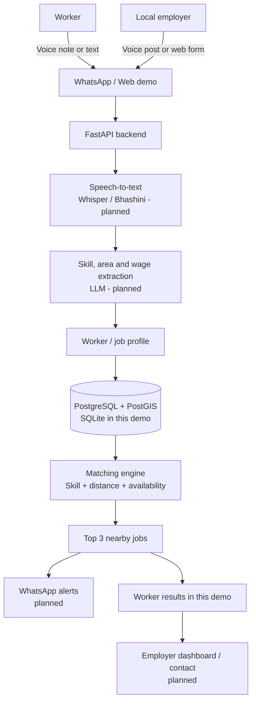
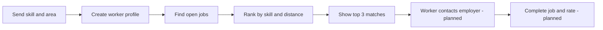

# KAYAKA — Voice-first, hyper-local job matching

> **Team Infinity · Track 4: UnlockED · wHACKiest 2026**  
> **Team ID:** `ee588213` · **College:** Sharnbasva University  
> **Tagline:** *Your skills. Your neighbourhood. Your next job.*

Kayaka is a lightweight prototype of a voice-first job board for informal and semi-skilled workers. It is designed around the workflow in the team's Track 4 presentation: a worker shares their skill and area, the system creates a simple worker profile, ranks nearby openings, and presents the best matches. Local employers can publish short-term or permanent openings through a simple form.

This repository is a **runnable demonstration prototype**, not a production job marketplace. It demonstrates the core user journey with seeded sample jobs and a local SQLite database. Browser speech recognition is an optional voice-input demonstration; production-grade Kannada/Hindi speech recognition, WhatsApp messaging, OTP, ratings and PostGIS are integration steps described below.

---

## 1. The problem

Informal and semi-skilled workers in non-metro towns and villages often miss nearby work because mainstream job platforms commonly assume resumes, English proficiency, app familiarity and lengthy forms. At the same time, small employers and contractors have difficulty finding available local workers quickly.

**Primary users**
- Workers: plumbers, electricians, masons, helpers and daily-wage earners.
- Employers: local shops, contractors and workshops.

**Product principle:** Workers should be able to express what work they can do in a familiar, low-friction way. Matching should prioritize skill, distance and availability.

## 2. The solution

Kayaka is a voice-first, hyper-local job board. In the proposed full system, workers can send a voice note through WhatsApp in Kannada, Hindi or English. Speech recognition converts the note to text; an extraction layer identifies skill, area and wage expectations; a matching engine ranks open jobs; and the worker receives the top nearby opportunities.

The prototype implements the central workflow in a browser:
1. A worker enters a name, skill and area (or tries browser voice input).
2. FastAPI stores the worker profile.
3. The matching endpoint ranks seeded and newly posted jobs using skill overlap and distance.
4. The worker sees up to three ranked job cards.
5. An employer can add a new job listing from the employer section.

## 3. Product flow



### Worker journey



### Matching logic in this demo

The demo uses a deliberately transparent baseline score:

- **Skill score:** 1 when the worker's skill words overlap with the job's skill/title words; otherwise 0.
- **Distance score:** a simple proximity score based on the worker's preferred distance and the job's sample distance.
- **Final score:** `75% × skill score + 25% × distance score`.
- The top three results are returned.

This is a demonstration ranking rule, not a validated hiring or suitability assessment. The prototype uses sample distances rather than live geocoding.

## 4. Interface design

The UI uses a calm, high-contrast green palette and large, simple interaction areas:
- **Worker-first landing page:** clear call to action and a map-inspired local-jobs visual.
- **Worker profile panel:** only essential details, with optional browser voice input.
- **Match results:** readable cards with role, employer, area, distance, wage and match score.
- **Employer panel:** a compact form for publishing a local opening.
- **Responsive layout:** adapts to mobile screens.

The map artwork is illustrative; the prototype does not display a live map or track a user's location.

## 5. Architecture and technology

| Layer | Team PPT proposal | This prototype |
|---|---|---|
| Worker channel | WhatsApp Cloud API / Telegram | Responsive web UI |
| Employer frontend | React | HTML, CSS and JavaScript |
| Backend | Python FastAPI | Python FastAPI |
| Database | PostgreSQL + PostGIS (Supabase) | SQLite for zero-setup local demo |
| Speech | Whisper / Bhashini ASR | Browser Web Speech API, if supported |
| Extraction | LLM API | Direct form input; no LLM call |
| Geo matching | PostGIS radius queries | Sample distance + skill score |
| Notifications | WhatsApp alerts | On-screen match results |
| Deployment | Render / Railway + Supabase | Run locally; deployable with configuration |

### Why SQLite in the demo?

SQLite keeps the prototype easy to run without cloud credentials or database provisioning. For a production-aligned build, replace the SQLite connection layer with PostgreSQL and use PostGIS geography points and radius queries. Do not represent the current demo as already using PostGIS.

## 6. Run locally

### Requirements
- Python 3.10+
- Internet connection only for downloading Python dependencies (the app itself runs locally).

### Setup

```bash
# 1. Extract the project and enter its folder
cd kayaka-prototype

# 2. Create and activate a virtual environment
python -m venv .venv

# Windows PowerShell:
.venv\Scripts\Activate.ps1

# macOS / Linux:
source .venv/bin/activate

# 3. Install dependencies
pip install -r requirements.txt

# 4. Start the app
uvicorn app:app --reload
```

Open **http://127.0.0.1:8000** in your browser.

The database file `kayaka.db` is created automatically and seeded with sample jobs on first launch. To reset the demo data, stop the server and delete `kayaka.db`; it will be recreated at next startup.

### Quick demo script

1. Open the home page and scroll to **Find your next workday**.
2. Enter a name such as `Ramesh`, skill `electrician`, area `Vijay Nagar`, and preferred distance `5`.
3. Select **Find my nearby jobs**. The page displays up to three ranked sample opportunities.
4. Scroll to **For local employers** and post a job such as `Electrician helper`, skill `electrician`, area `Vijay Nagar`, wage `700`.
5. Submit another worker profile to see the newly posted listing included in matching.
6. Try the microphone button in a browser that supports the Web Speech API. If voice recognition is unavailable, type the skill.

## 7. API reference

FastAPI also provides interactive API documentation at **http://127.0.0.1:8000/docs**.

| Method | Endpoint | Purpose |
|---|---|---|
| `GET` | `/` | Serve the web prototype |
| `GET` | `/api/health` | Basic health check |
| `GET` | `/api/jobs` | List open and seeded job records |
| `POST` | `/api/jobs` | Create an employer job listing |
| `POST` | `/api/workers` | Create a worker profile |
| `GET` | `/api/matches/{worker_id}` | Return up to three ranked matches |

### Example health check

```bash
curl http://127.0.0.1:8000/api/health
```

### Example: create a worker

```bash
curl -X POST http://127.0.0.1:8000/api/workers \
  -F "name=Ramesh" \
  -F "skill=electrician" \
  -F "area=Vijay Nagar" \
  -F "distance=5" \
  -F "availability=Available now"
```

Use the returned worker `id` in `/api/matches/{id}`.

## 8. Repository structure

```text
kayaka-prototype/
├── app.py                 # FastAPI routes, SQLite setup and matching logic
├── requirements.txt       # Python dependencies
├── .env.example           # Placeholders for future integrations
├── .gitignore
├── README.md              # Product, flow, architecture and setup guide
└── static/
    ├── index.html         # Worker and employer experience
    ├── style.css          # Responsive visual design
    └── app.js             # Form submission, matching display and voice input
```

## 9. Roadmap: prototype to the PPT vision

### Phase 1 — Hackathon demo
- [x] Worker profile creation
- [x] Employer job posting
- [x] Seeded local job listings
- [x] Skill and distance-based top-three matching
- [x] Responsive worker/employer interface
- [x] Optional browser voice input
- [ ] Real WhatsApp integration
- [ ] Production speech-to-text and multilingual extraction

### Phase 2 — Pilot-ready build
- Integrate WhatsApp Cloud API or Telegram bot after credentials and approval.
- Integrate Whisper or Bhashini ASR for Kannada and Hindi voice notes.
- Add LLM-based extraction of skill, area, wage and availability, with read-back confirmation and manual correction.
- Move to PostgreSQL + PostGIS for geocoding and radius-based matching.
- Add phone OTP, employer verification, job reporting and consent-based notifications.
- Add worker/employer ratings after completed jobs.

### Phase 3 — District expansion
- Add more languages and district-level local job categories.
- Partner with ITIs, contractors, shops and local organizations.
- Measure match time, successful hires, distance to matched jobs and worker onboarding completion.

## 10. Trust, safety and privacy

This is a demonstration and must use synthetic sample data. Do not enter real personal phone numbers or sensitive information. The prototype does not implement authentication, OTP, identity verification, payment, messaging or fraud detection. A production deployment should add consent, data minimization, secure authentication, employer/job verification, reporting and deletion controls before handling real users.

The match score is only a ranking aid. It must not be presented as a guarantee of employment or worker competence.

## 11. Demo limitations

- The demo uses SQLite and sample distances, not PostgreSQL/PostGIS.
- Browser speech recognition availability and language support vary by browser and device. The voice button is an optional demonstration, not the production Kannada/Hindi voice pipeline.
- No WhatsApp messages, SMS, phone calls or OTPs are sent.
- No real-time map, geocoding, payments, chat or ratings are implemented.
- The matching algorithm is a simple baseline and should be evaluated with workers and employers before real deployment.

## 12. Team

**Team Infinity — Sharnbasva University**  
**Track:** Track 4 — UnlockED (Hyper-Local Job Matching for Informal & Semi-Skilled Workers)  
**Team ID:** `ee588213`

| Member | Role |
|---|---|
| Kiran | Team Lead |
| Srijani | Team Member |
| Eshwar | Team Member |
| Somnath | Team Member |

---

**Kayaka — Speak your skill. Find work nearby.**
